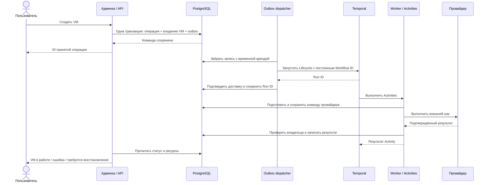

# Продуктовые возможности и архитектура выполнения операций

Демо показывает управление жизненным циклом VM: пользователь отправляет команду,
видит её выполнение и получает подтверждённый результат. PostgreSQL хранит
состояние продукта и распределение ресурсов, Temporal выполняет многошаговый
сценарий, а отдельный провайдер управляет инфраструктурой.

В этом проекте провайдер — HTTP-симулятор. Реальных гипервизоров, биллинга,
резервных копий и S3-интеграции здесь нет.
Запуск и сценарий показа: [README.md](../README.md).

## Основные продуктовые фичи

| Возможность | Что получает пользователь |
| --- | --- |
| Создание VM | Выбирает CPU, RAM, размер диска и необходимость GPU. Система резервирует ресурсы, создаёт экземпляр, подключает сеть, запускает VM и проверяет готовность. |
| Остановка | Освобождает CPU/RAM/GPU, сохраняя диск и IP. В текущей модели вычислительный экземпляр удаляется; данные диска остаются. |
| Повторный запуск | Использует сохранённые диск и IP, заново выделяет вычислительные ресурсы. VM может оказаться на другой ноде. |
| Удаление | Останавливает экземпляр и освобождает ресурсы после подтверждения его отсутствия. Запись о VM и история операций сохраняются. |
| Восстановление после сбоя | Команда `cleanup` продолжает безопасную очистку до сохранённого целевого состояния. Для существовавшей VM после ошибки start/stop диск и IP сохраняются. |
| Наблюдение за выполнением | В админке доступны статус операции, доставка, завершённые шаги, ошибка и ссылка на конкретный запуск workflow в Temporal. |
| Инвентарь ресурсов | Видны ёмкости нод, занятые и свободные CPU/RAM, владельцы GPU, диски и IP. Это учёт резервов, а не мониторинг фактической нагрузки. |
| Защита повторной отправки | Одинаковая команда с тем же `request_id` возвращает прежнюю операцию. Изменение команды при сохранении ID отклоняется. |
| Защита от конфликтующих команд | На одну VM допускается одна активная операция. При необходимости восстановления обычные команды блокируются до `cleanup`. |
| Готовность к показу | Docker Compose автоматически подготавливает БД, инвентарь и примеры успешных и неуспешных операций. |

Админка содержит список VM, карточку машины, журнал операций, карточку операции
и страницу ресурсов. Инициатор команды сохраняется для диагностики, но его имя
не является аутентификацией: пользователи, роли и разграничение доступа в демо
не реализованы.

## Как проходит команда

Принятая команда, доставленная команда и завершённая операция — разные состояния.
Ответ API означает, что запрос сохранён. Он ещё не означает, что VM создана.
Успешный запуск workflow означает передачу исполнения Temporal, но не готовность VM.

Транзакции PostgreSQL короткие. Они не остаются открытыми во время сетевых запросов
к Temporal или провайдеру. Поэтому сбой внешнего сервиса не удерживает блокировку
БД на всё время операции.

### Зачем остаётся `vm_operations`, если есть workflow

`vm_operations` связывает запрос пользователя, VM, автора, Workflow ID, результат
и цель восстановления. Она участвует в транзакции приёма команды и в проверках
владения VM. API читает из неё состояние операции без обращения к Temporal.

Temporal хранит историю исполнения: какие Activities были назначены, что они
вернули и что делать дальше. `vm_operations` нужна для правил и данных приложения;
для восстановления самого workflow после перезапуска worker она не требуется.
Поля прогресса частично дублируют Temporal, поэтому расхождения нужно обнаруживать.

## Как работает outbox

### Проблема, которую он решает

Нельзя одной обычной транзакцией атомарно изменить PostgreSQL и вызвать Temporal.
Если сначала сохранить операцию и затем запустить workflow, процесс может упасть
между этими действиями. В БД останется принятая команда, о которой Temporal ничего
не знает. Обратный порядок тоже опасен: workflow может стартовать без записанной
операции приложения.

Outbox сохраняет **намерение запустить workflow в той же транзакции, что и команду**.
Если транзакция откатилась, не появится ни принятой операции, ни задания доставки.
Если зафиксировалась, dispatcher сможет найти задание после перезапуска.

### Приём и доставка

1. `Accept` проверяет команду и её ID, блокирует строку VM и проверяет допустимость
   новой операции. Повтор с тем же ID и содержимым возвращает прежний результат.
2. Операция, право владения VM и запись `outbox` создаются одной транзакцией.
   CPU, GPU, диск и IP резервируются позже, внутри исполнения workflow.
3. Dispatcher выбирает недоставленную запись активной операции. `SKIP LOCKED`
   позволяет другим dispatcher пропустить уже забранную строку.
4. Запись получает аренду на 30 секунд и случайный `lease_token`. Если процесс
   упал, после окончания аренды запись сможет забрать другой исполнитель.
5. Dispatcher запускает `Lifecycle` с постоянным Workflow ID, включающим тип
   операции, VM и ID запроса. Сетевой вызов выполняется вне транзакции приёма.
6. При успехе dispatcher одной транзакцией отмечает доставку и сохраняет Run ID.
   Запись обновляется только при совпадении токена: старый исполнитель не сможет
   подтвердить запись после передачи аренды другому.
7. При ошибке назначается повтор с растущей задержкой и случайной добавкой.
   Верхняя граница задержки — минута. Отдельной очереди окончательно неуспешных
   доставок и ограничения числа попыток в этом dispatcher нет.

### Что происходит при потерянном ответе

Допустим, Temporal запустил workflow, но dispatcher не получил ответ или упал до
записи `delivered_at`. Он повторит запуск с прежним Workflow ID. Политика
`REJECT_DUPLICATE` предотвращает повторный запуск, пока Temporal хранит сведения
об этом execution. Ответ `AlreadyStarted` признаётся успешной доставкой только
после проверки типа `Lifecycle` и `operation_id` в Memo существующего workflow.

Это доставка с возможными повторами — **at least once**, а не распределённая
транзакция и не обещание «каждый внешний эффект выполнится ровно один раз».
Дедупликация Workflow ID зависит от сохранности истории Temporal; после её удаления
она не является вечной защитой. Терминальные операции приложения dispatcher
повторно не запускает.

### Гарантии и условия

| Ситуация | Поведение |
| --- | --- |
| Процесс упал после фиксации команды | Задание доставки осталось в БД. |
| Temporal недоступен | Команда остаётся принятой; доставка повторяется. |
| Worker выключен, Temporal доступен | Workflow может быть запущен и ждать исполнителя. |
| Ответ на запуск потерялся | Повтор использует прежний Workflow ID и проверяет существующий запуск. |
| Dispatcher потерял аренду | Прежний токен не позволяет перезаписать подтверждение нового владельца. |

Последующая доставка требует сохранной БД, работающего dispatcher, восстановления
Temporal и устранения постоянных ошибок конфигурации. Outbox не обещает выполнение
за фиксированное время. `delivered_at` означает подтверждение передачи в Temporal,
а не успешное создание VM.

Реализация: [приём команды](../internal/postgres/operations.go),
[dispatcher](../internal/outbox/dispatcher.go),
[подтверждение доставки](../internal/postgres/outbox.go),
[SQL выбора и аренды](../internal/postgres/queries/store.sql).

## Почему выбираем Temporal для этих задач

Создание VM состоит из нескольких внешних действий. Между ними могут пройти
секунды или минуты, процесс может перезапуститься, ответ провайдера — потеряться,
а ошибка на позднем шаге потребует отменить уже сделанные изменения.
Для такого класса задач Temporal даёт готовый механизм устойчивого исполнения.

**Для этого демо Temporal предпочтительнее собственного оркестратора поверх
очереди:** существенная часть сложности уже решена платформой, а сценарий
жизненного цикла остаётся обычной последовательностью шагов в Go.

| Задача | Что даёт Temporal | Что пришлось бы реализовать поверх обычной очереди |
| --- | --- | --- |
| Продолжить работу после сбоя worker | Сохранённую историю и восстановление workflow через replay | Хранение текущего шага, результатов и логику возобновления |
| Повторить временно неуспешный шаг | Политики повторов, задержки и таймауты Activities | Планировщик повторов, учёт попыток и их сроков |
| Выполнить шаги по порядку | Ожидание результата Activity внутри workflow | Машину состояний и передачу сообщений между этапами |
| Очистить частично созданную VM | Устойчивое исполнение написанного нами сценария компенсации | Возобновляемую цепочку компенсаций и её состояние |
| Разобраться в инциденте | Историю событий, попытки, ошибки и временную диаграмму в UI | Собственную корреляцию журнала событий и диагностический интерфейс |

При replay Temporal подставляет записанные результаты уже завершённых Activities.
Однако Activity может выполниться повторно, если внешний эффект произошёл,
а подтверждение не дошло. Поэтому провайдер всё равно обязан понимать устойчивый
ключ команды и возвращать прежний результат при повторе.

В этом проекте повторяемый запрос сохраняется в БД до внешнего вызова.
Ключ включает операцию, фазу и шаг. При записи результата проверяются владелец VM,
поколение и фаза. Это дополняет Temporal защитой данных и внешних эффектов.

### Компенсация — часть нашего кода

Temporal сам не знает, как удалить экземпляр или когда можно освободить GPU.
Эти правила задаёт `Lifecycle`: при ошибке он переключается на откат,
останавливает экземпляр, отключает сеть, удаляет экземпляр и освобождает ресурсы.
Откат выполняется в отдельном контексте, чтобы обычная отмена запроса не отменила
саму очистку. Принудительный `terminate` обходит этот код.

Политики повторов имеют пределы: основные Activities допускают до пяти попыток,
очистка ограничена временным бюджетом. Временная ошибка может исчезнуть после
повтора; постоянная нехватка ресурсов от повтора не исправится. Если безопасное
завершение очистки не подтверждено, система сохраняет резервы и требует восстановления.

### Где проходит граница преимущества

Temporal не заменяет транзакции и ограничения PostgreSQL, учёт общей ёмкости
ресурсов, идемпотентность провайдера и сверку фактического состояния инфраструктуры.
Он также требует эксплуатации отдельного сервиса и аккуратного изменения workflow:
новый код должен оставаться совместимым с историей уже запущенных процессов.

Для короткой независимой задачи обычной очереди может быть достаточно.
Для рассылки событий нескольким подписчикам RabbitMQ тоже сохраняет свою роль.
Выбор Temporal здесь обоснован именно многошаговыми операциями, восстановлением
после сбоев и компенсациями. Утверждать, что он лучше любого другого решения
для всех задач, оснований нет. В демо RabbitMQ не подключён; его возможное
сосуществование с Temporal в реальной платформе требует отдельного решения.

Реализация: [workflow](../internal/orchestration/lifecycle.go),
[политики повторов](../internal/orchestration/workflow.go),
[выполнение внешних шагов](../internal/execution/service.go),
[подготовка и фиксация команд](../internal/postgres/commands.go).

## Зачем нужен reconciler и что он гарантирует

### Как возникает расхождение

Представим, что создание VM уже выделило GPU, но оператор принудительно завершил
workflow через `terminate`. Код отката не выполнится. В PostgreSQL операция
может остаться `running`, а её ресурсы — занятыми. Аналогичное расхождение возможно
при завершении workflow до фиксации результата в БД или при отсутствии его истории.

Reconciler периодически сверяет незавершённые операции приложения с Temporal.
Его задача — выявить ситуацию «БД ждёт продолжения, а соответствующий workflow
уже не выполняется» и перевести её в явное состояние восстановления.

### Алгоритм текущей реализации

1. Каждые 10 секунд выбираются операции `pending`/`running`, для которых outbox
   уже подтвердил доставку (`delivered_at` заполнено).
2. Для каждой запрашивается состояние конкретного workflow по Workflow ID и Run ID.
3. Если Temporal сообщает `RUNNING`, операция остаётся без изменений.
4. При сетевой ошибке или иной ошибке запроса, кроме `NotFound`, записывается
   предупреждение. Недоступность Temporal не считается доказательством остановки VM.
5. Если workflow закрыт или получен `NotFound`, reconciler начинает транзакцию БД.
   В ней повторно проверяются активность операции и её владение VM: операция
   могла успеть завершиться после первоначального чтения.
6. Если расхождение ещё актуально, выставляются фаза `rollback`, статус
   `rollback-blocked`, описание причины и `recovery_required=true` у VM.
   При переходе из прямого выполнения повышается поколение владения.
   Ресурсы сохраняются, состояние VM берётся из последних подтверждённых данных.

### Что гарантируется после фиксации этой транзакции

| Гарантия | За счёт чего |
| --- | --- |
| Операция больше не выглядит бесконечно выполняющейся | В БД сохранён явный терминальный статус `rollback-blocked` и причина. |
| Обычные команды не продолжат работу с VM, требующей восстановления | Приём команды проверяет `recovery_required` и разрешает только `cleanup`. |
| Запоздалый результат старой операции не перезапишет состояние приложения | `Prepare` и `Commit` проверяют активность операции, владельца, поколение и фазу. |
| Потенциально занятые ресурсы не будут освобождены только из-за исчезновения workflow | Reconciler не выполняет освобождение резервов. |
| Завершившаяся за время проверки операция не будет заблокирована по устаревшему снимку | Активность и владение повторно проверяются под блокировками в транзакции. |

Это гарантия безопасной фиксации проблемы. Она не означает автоматическое
исправление инфраструктуры или обязательное завершение любой операции.

### Блокировка в БД и Fence провайдера — разные действия

Метод хранилища `Fence`, вызываемый reconciler, меняет состояние **в PostgreSQL**.
Он не отправляет команду провайдеру. Уже принятый внешний запрос может ещё
выполниться, хотя его результат приложение больше не примет.

Команда `cleanup` получает новое владение, а при исполнении подтверждает
**Fence у провайдера** — барьер, после которого команды прежних поколений не должны
менять VM. Затем проверяет состояние и выполняет очистку. Освобождение резервов
разрешено после подтверждённого отсутствия вычислительного экземпляра, с учётом
того, нужно ли сохранить диск и IP.

Для реального гипервизора этот контракт должен учитывать уже принятые
асинхронные задания. Одного изменения номера поколения в нашей БД недостаточно.

### Что reconciler не гарантирует

- **Исправление за 10 секунд.** Это период запуска проверки, а не SLA: запросы
  выполняются последовательно, каждый может ждать до 10 секунд; ошибки откладывают работу.
- **Обнаружение зависшего `RUNNING`.** Пока workflow числится работающим, текущая
  проверка его не блокирует и не оценивает скорость продвижения.
- **Доставку потерявшего исполнителя outbox.** Недоставленные записи обслуживает
  dispatcher; reconciler их не выбирает.
- **Сверку гипервизора с БД.** Он обращается к Temporal, а не к инфраструктуре.
  Расхождение уже успешно завершённой VM с фактическим состоянием здесь не ищется.
- **Автоматический cleanup.** Reconciler фиксирует проблему; восстановление
  запускается отдельной командой из админки или CLI.
- **Остановку старого внешнего запроса.** Для этого требуется барьер провайдера,
  который выполняет дальнейший сценарий восстановления.

Обнаружение требует работающего reconciler, доступной БД и возможности получить
достоверный ответ Temporal. Compose запускает один reconciler; распределение
его работы между несколькими экземплярами и production-оповещения не реализованы.

Реализация: [цикл сверки](../internal/reconcile/reconciler.go),
[транзакция блокировки](../internal/postgres/reconcile.go),
[проверка итогового состояния](../internal/postgres/operation_outcome.go).

## Как компоненты дополняют друг друга

| Компонент | Основная ответственность |
| --- | --- |
| PostgreSQL | Принять команду атомарно, защитить владение VM, учитывать и резервировать ресурсы. |
| Outbox | Сохранить намерение запуска и повторять передачу активной операции в Temporal. |
| Temporal | Хранить ход процесса, назначать Activities, управлять повторами и исполнять сценарий компенсации. |
| Провайдер | Выполнить внешний эффект, распознать повтор и обеспечить барьер для старого поколения. |
| Reconciler | Обнаружить расхождение активной операции с закрытым или отсутствующим workflow и заблокировать небезопасное продолжение. |
| Cleanup | Подтвердить состояние провайдера и безопасно довести восстановление до сохранённой цели. |

Устойчивость получается из совместной работы этих механизмов. История Temporal
не делает изменения инфраструктуры частью транзакции PostgreSQL, а наличие outbox
не отменяет необходимости проверять результат операции.
